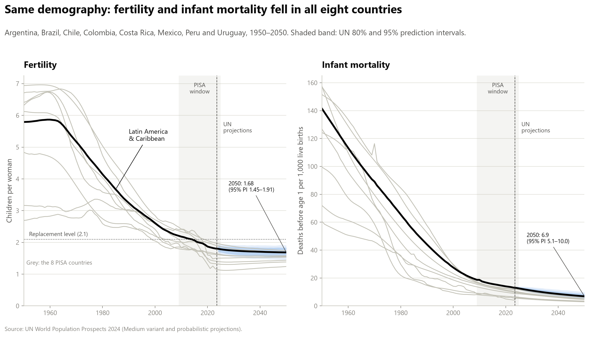
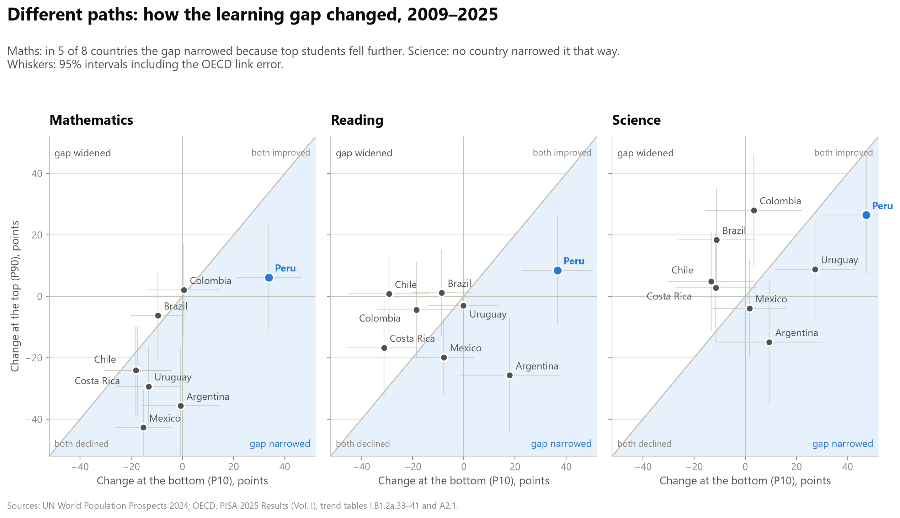
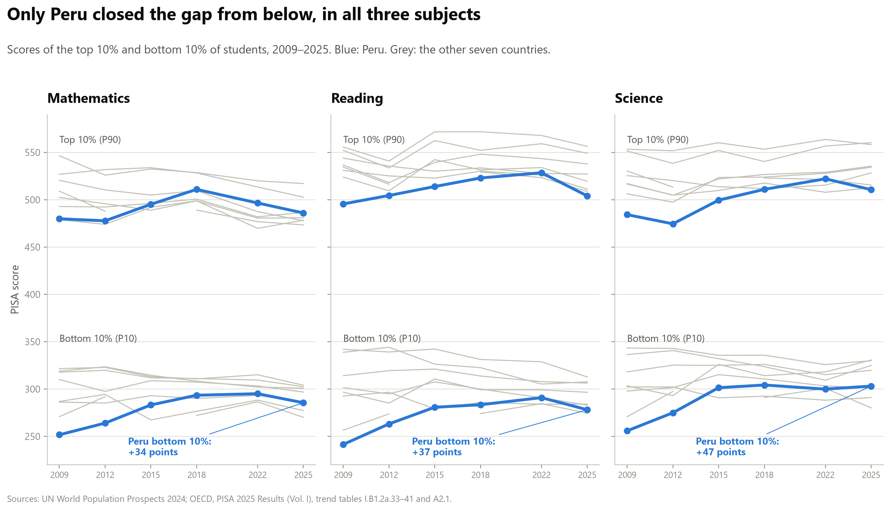
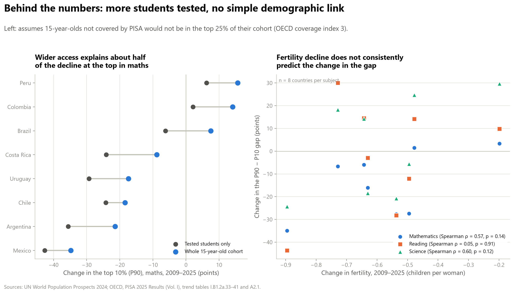

# Report: Same demography, different paths

> Written for someone who **will not open any notebook**. Each finding rests on a figure in `figures/`. Team Aperture · ASA DataQuest 2026.

## 1. Context and questions (Business Understanding)

**Audience:** the ASA DataQuest jury and a general audience interested in Latin America, demography and education. No technical background is assumed; methods are explained in plain terms.

**Objective:** understand whether the demographic transition in Latin America (fewer children per woman, fewer infant deaths) went hand in hand with more equal learning among 15-year-olds.

**Central question:** *Between 2006 and 2025, as fertility and infant mortality fell across Latin America, did learning inequality within countries shrink or grow?* It draws on questions 1 and 7 of the ASA guide (age structure over time; how fertility and mortality shape countries' trajectories).

**Questions that guide the analysis:**

1. Did the eight countries go through the same demographic transition?
2. How did learning inequality change between 2009 and 2025, and in which direction: did the bottom catch up, or did the top fall?
3. Is any country an exception?
4. How much of the change reflects more young people reaching the test, and does demographic change predict the change in inequality?

## 2. The data

- **Demography:** UN World Population Prospects 2024 (Medium variant and probabilistic projections), 1950–2100. One row per country and year. Only countries are used (aggregates are kept apart to avoid double counting). Values after 2023 are projections and are always shown with their 80% and 95% prediction intervals.
- **Learning:** OECD PISA trend tables from *PISA 2025 Results (Vol. I)*, tables I.B1.2a.33–41: percentiles 10, 25, 50, 75 and 90 and the share of students below proficiency Level 2, with standard errors, for mathematics, reading and science. Official 2009→2025 changes include the OECD link error between cycles.
- **Coverage:** OECD coverage index 3 (table I.A2.1): the share of all 15-year-olds that each PISA sample represents.
- **Countries:** Argentina, Brazil, Chile, Colombia, Costa Rica, Mexico, Peru and Uruguay, the only Latin American countries with PISA in all six cycles from 2009 to 2025 (47 country-cycles per subject).

**Main decisions (all fixed before looking at results):**

- Learning inequality is measured in two ways: the **P90 − P10 gap** (distance between the top and bottom 10% of students) and the **share below Level 2** (students without basic proficiency).
- Mathematics is the main subject; reading and science test whether results hold.
- **Argentina 2015 is excluded**: the OECD considers it not comparable (its coverage fell to 0.55) and publishes no value for it in the trend tables.
- How a gap changed is classified by the movement of P10 and P90: it **narrowed from below** if the bottom rose, **narrowed from the top** if the bottom did not rise and the top fell further, and likewise for widening.

## 3. Findings

### 3.1 Same demography: fertility and infant mortality fell in all eight countries

Between 2009 and 2025, fertility fell in every country, from 0.2 children per woman (Brazil) to 0.9 (Argentina), and infant mortality dropped by 32% to 42%. The region has been below replacement fertility (2.1) since 2014. The UN projects 1.68 children per woman by 2050 (95% PI 1.45–1.91) and infant mortality of 6.9 per 1,000 (95% PI 5.1–10.0), down from 13.1 in 2023.

### 3.2 Different paths: learning inequality did not follow one pattern

| How the gap changed | Mathematics | Reading | Science |
|---|---|---|---|
| Narrowed from below (bottom rose) | 1 | 2 | 4 |
| Narrowed from the top (top fell further) | **5** | 2 | 0 |
| Widened from the top (top rose) | 1 | 2 | 4 |
| Widened from below (bottom fell further) | 1 | 2 | 0 |

- **Mathematics:** the gap narrowed in Argentina, Mexico, Uruguay, Chile and Costa Rica because the best students fell further than the weakest (median: P90 −24 points, P10 −11). P90 fell clearly in 5 countries and the share below Level 2 rose clearly in 5.
- **Science:** no country narrowed the gap from the top and no P90 fell clearly. In Brazil, Chile, Colombia and Costa Rica the gap widened because top students improved.
- **Reading:** no dominant pattern.

### 3.3 Peru is the consistent exception

Peru is the only country that narrowed the gap from below in all three subjects: its bottom 10% improved by 34 points in mathematics, 37 in reading and 47 in science, while most other countries' bottom 10% stayed flat or declined.

### 3.4 Wider access explains part of the change; demographic change does not predict it

- **Coverage:** PISA coverage rose by 9 to 20 percentage points in all eight countries. Newly tested students tend to sit lower in the distribution, which mechanically pulls observed percentiles down. Assuming that 15-year-olds not covered by PISA would not be in the top 25% of their cohort, the median fall of the top 10% in mathematics shrinks from −24 to −13 points. Still, the top 10% of the whole cohort fell in Mexico (−35), Argentina (−21), Chile (−18), Uruguay (−17) and Costa Rica (−9).
- **Demography:** across countries, the size of the fertility decline is not consistently related to the change in the gap (Spearman ρ = 0.57, 0.05 and 0.60 for mathematics, reading and science; none significant, n = 8). Within countries, cycles with higher fertility had wider mathematics gaps (about 12–18 points per child), but the relation does not appear in reading or science. Using fertility and infant mortality in the students' birth year (cycle − 15) does not reveal a clearer link.

**Robustness.** Each result was recomputed nine times (with all countries and leaving out each one). In all nine versions, the top fell more than the bottom in mathematics, and no country narrowed the science gap from the top. The within-country fertility relation in mathematics holds in 8 of 9 versions; in reading and science its sign depends on which country is left out.

## 4. Conclusions

1. **Same demography:** yes. All eight countries went through the same transition, and the UN projects it to continue to 2050.
2. **Learning inequality:** it did not change in one direction. In mathematics it narrowed mostly because the best students fell; in science it narrowed from below in half the countries and widened because the top improved in the other half; reading is mixed.
3. **The exception:** Peru narrowed the gap by lifting its weakest students in all three subjects, showing that closing the gap from below is possible.
4. **Mechanisms:** wider access to school explains about half of the decline at the top in mathematics, and demographic change does not consistently predict the change in inequality.

**Answer to the central question:** as fertility and infant mortality fell, learning inequality did not simply shrink or grow; it followed different paths by subject and country, and those paths are not explained by the demographic transition itself. *Same demography, different paths.*

## 5. Limitations and next steps

- **Eight countries:** results are descriptive. Correlations with n = 8 are fragile, and clustered standard errors with 8 clusters are unreliable; findings are reported as patterns, not proofs.
- **Association, not causation:** income, education spending and school expansion may drive both demography and learning. Country-level data say nothing about individual students or families (ecological fallacy).
- **Multiple comparisons:** 24 models and 12 correlations were estimated for the demographic link; about 1 significant result would be expected by chance. Only patterns that repeat across subjects are treated as findings.
- **Selection and coverage:** PISA represents enrolled 15-year-olds (69–95% of the cohort in 2025 in these countries). The coverage correction relies on an assumption about those not tested and only adjusts the top of the distribution.
- **Projections:** 2025 values in the UN data and everything after 2023 are projections, shown with their prediction intervals.
- **Comparability:** PISA 2022 was affected by the pandemic; comparisons across cycles carry link error, included in the OECD changes used here.
- **Next steps:** study what Peru did differently (curriculum, targeting of low performers, school expansion), add socio-economic gradients over time (OECD tables I.B1.2b), and extend the panel as more Latin American countries accumulate PISA cycles.

*Process, decisions and quality checks: [docs/bitacora.html](docs/bitacora.html). Code: notebooks `02b` to `03`. Video: script in [docs/guion_video.md](docs/guion_video.md) and slides in [docs/diapositivas_ASAPRAperture.pdf](docs/diapositivas_ASAPRAperture.pdf).*
